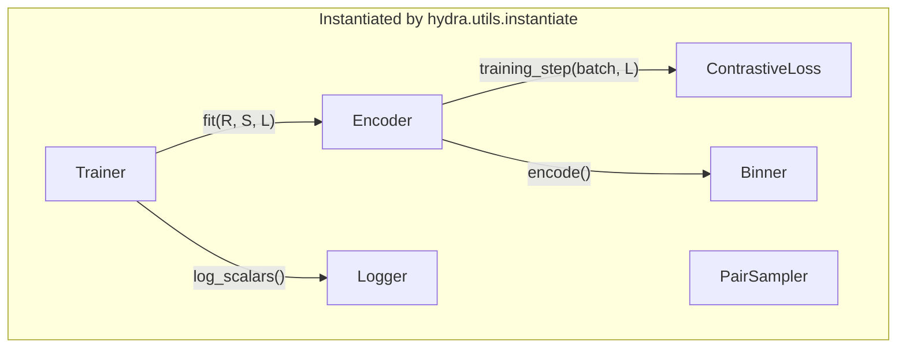

# Slots and Protocols

Each slot is a `@runtime_checkable` Protocol and verified by `tests/test_interfaces.py`. Components also declare **contracts** (`needs` / `provides`, by port and label); see [Contracts and stages](contracts-and-stages.md).

## `Encoder`

[`megobin/encoders/base.py`](https://github.com/Tinnifo/Metagenomic-Binning/blob/main/megobin/encoders/base.py)

```python
class Encoder(Protocol):
    needs: Mapping[str, frozenset[str]]      # {"features": {"kmer", "depth"}}
    provides: frozenset[str]                 # labels of z it can send: {"mu"} / {"mu", "var"}
    def feature_view(self) -> FeatureView: ...
    def encode(self, features: np.ndarray) -> np.ndarray: ...
    def encode_z(self, features: np.ndarray) -> Z[np.ndarray]: ...
    @property
    def embedding_dim(self) -> int: ...
    def training_step(self, batch, loss_fn) -> torch.Tensor: ...
    def parameter_groups(self) -> dict[str, list[nn.Parameter]]: ...
```

- `needs` / `provides` — the encoder's contract: which feature labels it reads and which labels of `z` it can send.
- `feature_view` — the view of the feature matrix it trains on and encodes (replaces the `consumes_depth` / `is_combined` flags that `pipeline.py` used to read).
- `encode` — NumPy → NumPy, no grad; the point estimate. `encode_z` returns everything the encoder can send as a labelled `Z`.
- `training_step` — one batch → scalar loss. Encoder picks what to pass to the loss.
- `parameter_groups` — named subsets for phase-based trainers. Minimum: `{"all": [...]}`.

`UncertainGenEncoder` exposes `{"mean", "cov", "all"}` so two-phase trainers can freeze each head independently.

`training_step` lives on the encoder so different encoders can build different things for the loss. It builds a labelled `Z` containing exactly the fields in `loss.needs["z"]` (UncertainGen computes the covariance head only when the loss asks for `var`).

## `ContrastiveLoss`

```python
class ContrastiveLoss(Protocol):
    needs: Mapping[str, frozenset[str]]      # {"batch": {"views=2", "label"}, "z": {"mu"}}
    def __call__(self, z_i: Z, z_j: Z, label) -> torch.Tensor: ...
```

`z_i`, `z_j` are labelled `Z(mu, var=None)` objects (a bare tensor is accepted as `Z(mu=tensor)`). `label`: 1 = must-link, 0 = cannot-link.

- `HingeContrastiveLoss` — [SemiBin](https://github.com/BigDataBiology/SemiBin)'s loss ([SemiBin paper](https://www.nature.com/articles/s41467-022-29843-y)).
- `MahalanobisBCELoss` — UncertainGen's. `include_std` is the loss's own declaration of what it needs (`z.var` or `z.mu` only); each phase of the two-phase trainer declares its own loss.

## `Binner`

```python
class Binner(Protocol):
    needs: Mapping[str, frozenset[str]]      # {"z_kept": {"mu"}, "contigs": {"fasta"}}
    provides: Mapping[str, frozenset[str]]   # {"bins": {"one_label_per_contig"}}
    embedding: tuple[str, str]               # which (port, label) is clustered
    bindings: Mapping[str, str]              # constructor kwarg -> named runtime value
    def cluster(self, embeddings: np.ndarray) -> np.ndarray: ...
```

`(N, d)` → `(N,)` int labels. Non-parametric. Hyperparams via constructor; runtime inputs (contig FASTA, names, lengths, marker directory, optional graph) are declared in `bindings` and handed over by `BinnerStage` from the dataset manifest.

- `DBSCANEnsembleBinner` — 12 eps, marker-gene F1 selection. Marker resolution either takes a precomputed `contig_to_marker` dict or calls `_call_markers_from_fasta`, which runs an ORF finder ([megobin/utils/orffinding.py](https://github.com/Tinnifo/Metagenomic-Binning/blob/main/megobin/utils/orffinding.py); default `fast-naive` is pure-Python, optional [`prodigal`](https://github.com/hyattpd/Prodigal)/[`fraggenescan`](https://sourceforge.net/projects/fraggenescan/)) followed by [`hmmsearch`](http://hmmer.org/documentation.html) against [megobin/utils/marker.hmm](https://github.com/Tinnifo/Metagenomic-Binning/blob/main/megobin/utils/marker.hmm) (107 single-copy markers, [ported verbatim from SemiBin](https://github.com/BigDataBiology/SemiBin/blob/main/SemiBin/marker.hmm)). HMMER must be on PATH; see [installation.md](../02-getting-started/installation.md#external-tools).

## `Evaluator`

```python
class Evaluator(Protocol):
    def score(self, bins_dir: Path) -> pd.DataFrame: ...
```

The evaluator is **not a pipeline stage**: run it with `python -m megobin.evaluate bins_dir=<dir>`. `CheckM2Evaluator` raises `FileNotFoundError` if [CheckM2](https://github.com/chklovski/CheckM2) is not on PATH; the entry point reports it and exits with code 2. Output columns (`completeness`, `contamination`) follow the [CheckM2 quality_report.tsv](https://github.com/chklovski/CheckM2#how-to-interpret-the-output) schema.

## `PairSampler`

```python
class PairSampler(Protocol):
    def __len__(self) -> int: ...
    def __getitem__(self, idx) -> tuple[Tensor, Tensor, Tensor]: ...
```

`Dataset`-shaped, returns `(feature_i, feature_j, label)`. A sampler declares `provides` (batch labels, e.g. `views=2`, `label`), `needs` (`features: {split}`) and `bindings` (constructor kwarg → named value, e.g. `features_split`); the embedder stage supplies the values. Nothing introspects `__init__`.

- `UncertainGenPairSampler`, `SemiBin2PairSampler`.

## `Trainer`

```python
class Trainer(Protocol):
    def phase_losses(self, default) -> Sequence[ContrastiveLoss]: ...
    def fit(self, encoder, sampler, loss_fn) -> None: ...
```

`phase_losses(default)` lists the loss each phase uses so the contract check can verify every phase. Mutates `encoder` in place. Owns epochs, batching, optimizer, scheduler, clipping, phases, logger calls.

- `SinglePhaseTrainer`, `TwoPhaseTrainer`.

## `Logger`

```python
class Logger(Protocol):
    def log_scalars(self, values, step) -> None: ...
    def log_config(self, config) -> None: ...
    def log_text(self, key, text) -> None: ...
    def log_dataframe(self, key, df) -> None: ...
    def log_checkpoint(self, path, name="checkpoint") -> None: ...
    def finish(self) -> None: ...
```

`TensorBoardLogger` (default), `NoOpLogger` (silent).

## How they compose



No box imports another. That's the whole architecture.

The evaluator sits outside this diagram: it reads the `bins/` directory a run wrote (`python -m megobin.evaluate`).

Besides the seven slots above there are two more: `Filter` (`needs` on `z`) and `Refiner` (`megobin/refiners/base.py`, optional, resolved only for target `bins_refined`).
